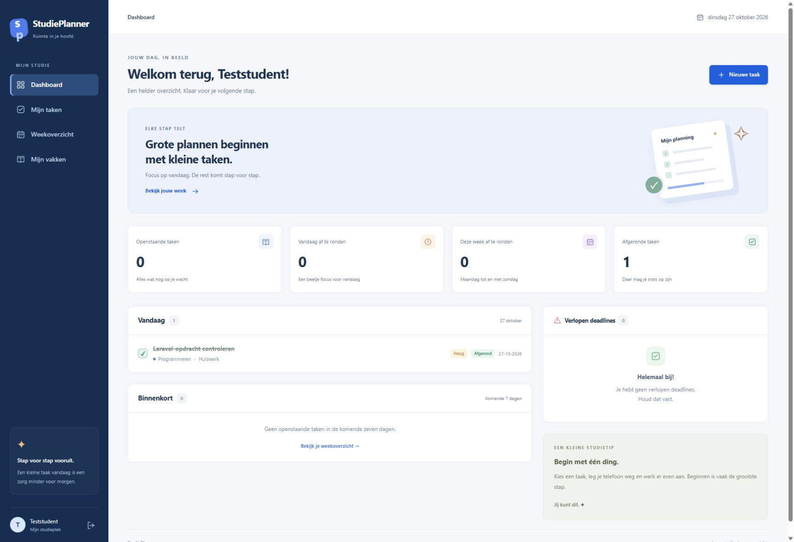

# StudiePlanner

Nederlandstalige planner voor huiswerk, toetsen, projecten en deadlines. Iedere student heeft een eigen account. De schermafbeelding hieronder laat de applicatie zien zonder dat je hem hoeft te installeren.

## Schermafbeeldingen

### Dashboard

Openstaande taken, wat vandaag en deze week af moet, en verlopen deadlines.



## Wat je ermee kunt

- Een account aanmaken, inloggen en uitloggen.
- Op het dashboard zien wat openstaat, vandaag af moet, deze week af moet en al afgerond is.
- Vandaag, de komende zeven dagen en verlopen deadlines apart bekijken.
- Vakken toevoegen, wijzigen, een kleur geven en verwijderen. Taken blijven bestaan als je een vak verwijdert.
- Taken toevoegen, bewerken, verwijderen, afronden en opnieuw openzetten.
- Filteren op status, type en vak.
- Een weekoverzicht van maandag tot en met zondag bekijken, inclusief de vorige en volgende week.

## Techniek

Laravel 13, Blade, gewone CSS, SQLite en PHPUnit. Een klein JavaScript-bestand vraagt bevestiging voordat je een taak of vak verwijdert. Er is geen Node.js of frontendbuild nodig.

## Clonen en starten

Je hebt Git, PHP 8.3 of nieuwer en [Composer](https://getcomposer.org) nodig.

```bash
git clone https://github.com/John07-Coder/StudiePlanner.git
cd StudiePlanner
composer run setup
php artisan serve
```

`composer run setup` maakt `.env`, de applicatiesleutel, `database/database.sqlite` en voert de migraties uit. Open daarna [http://127.0.0.1:8000](http://127.0.0.1:8000) en registreer een account. Een nieuw account begint leeg. Er is geen standaardwachtwoord.

## Tests

```bash
php artisan test
```

De tests gebruiken een SQLite-database in het geheugen. Je lokale `database/database.sqlite` blijft staan.

## Beveiliging

- Je ziet alleen je eigen taken en vakken. Een id van iemand anders levert 404 op.
- De client kan geen `user_id` meesturen. Een gekozen vak moet van jou zijn.
- Laravel verzorgt de sessie, de wachtwoordhash en CSRF.
- Inloggen is beperkt tot vijf pogingen per e-mailadres en IP-adres, met daarnaast een limiet per minuut op inloggen en registreren.
